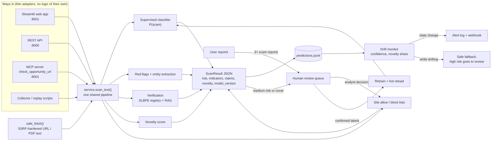

# SafePassage LK

Detects fraudulent local-job, overseas-job, student-visa and migration offers aimed at Sri Lankans, whether they arrive as posts, links or documents, and notices when scam tactics shift.

> TensorForge 2.0 Final-Forge build (17 Oct 2026). Results are risk assessments, not fraud determinations.

## Problem and users

Job fraud reaches Sri Lankans wherever they look for work:

- **At home:** Telegram/WhatsApp "task" jobs that pay small amounts first and then demand "prepaid tasks". Fake government and bank vacancies that misuse official logos to collect fees and NIC/passport copies. Sri Lanka CERT received 7,210 online-scam complaints in 2024, about 1,440 of them financial fraud, including job-offer fraud.
- **Abroad:** about 311,000 Sri Lankans left for foreign jobs in 2025. In the same year SLBFE received about 4,700 foreign-employment complaints, filed 791 court cases and recovered more than Rs. 374M. Single victims lose up to Rs. 13M, often borrowed.
- **Study and visas:** fake education and migration agents promise "guaranteed" admission, visas or PR.

These offers arrive as social-media posts, messages, links and official-looking letters, and the tactics keep changing: new destinations, new schemes (digital-ID "verification fees", crypto and QR payments), new platforms and new languages. A detector that is accurate on launch day quietly fails a few weeks later.

**Who we protect**
- **Primary:** first-time migrant workers (especially rural women and young men), local job seekers (school leavers, graduates, part-time and work-from-home seekers), students and their parents, and families applying for visit, work or PR visas.
- **Secondary:** investigators at SLBFE, Sri Lanka CERT and the Police CID/SCIB who triage complaints, plus job-centre officers, counsellors and pre-departure trainers. They use the analyst console.

**What it does:** scores an offer's scam risk with a trained classifier and explains the red flags (English, Sinhala, Tamil, Singlish). It checks the agency and fee claims against SLBFE data, flags unfamiliar patterns, and raises an alert when incoming offers drift away from what the model was trained on. Uncertain cases and repeatedly reported sites go to a human.

## Architecture



**Design rules**
- Every way in calls the same `scan_text()`, so the website, the API, AI assistants (via MCP) and the collectors get identical results.
- Only analyst decisions change the site lists or the training data. User reports and model output never do this on their own, which protects against brigading and data poisoning.
- Text from scanned pages is treated as data to classify, never as instructions.

## Run it

### With Docker (recommended)

```bash
docker compose up --build
```

| Service | URL |
|---|---|
| Web app (scan, monitoring, analyst console) | http://localhost:8501 |
| REST API + interactive docs | http://localhost:8000/docs |
| MCP server (Streamable HTTP, localhost only) | http://localhost:8001/mcp |

On first start the `api` container builds any missing models (`scripts/bootstrap.py`: dataset → train → calibrate drift, about 1–2 minutes, downloads EMSCAD). The web app and MCP server wait until the API is healthy. Later starts reuse the models.

`logs/`, `models/` and `data/processed/` are shared with the host. To use a newly trained model, click **Reload model** in the analyst console, or `POST /api/v1/model/reload`.

Optional: `ALERT_WEBHOOK_URL=https://... docker compose up` also posts drift alerts to a webhook.

Optional background jobs (off by default): `docker compose --profile jobs up --build` also starts the **retrain scheduler** (checks every 60 minutes, retrains after 20 new analyst-confirmed labels, or sooner during drift) and runs the **ikman collector** once (it scans new public listings through the API, then exits; run it again with `docker compose run --rm collector`).

### Without Docker (Python 3.14)

```bash
pip install -r requirements.txt
export PYTHONPATH=src            # PowerShell: $env:PYTHONPATH="src"
python scripts/bootstrap.py      # builds missing models once (until then a red-flag score is used)
uvicorn safepassage.api:app --port 8000
streamlit run app/streamlit_app.py
python -m safepassage.mcp_server
```

Screenshot scanning needs the Tesseract binary with the Sinhala and Tamil language packs. On Windows, use the [UB-Mannheim installer](https://github.com/UB-Mannheim/tesseract/wiki) and tick **Sinhala** and **Tamil** under additional languages. On Debian/Ubuntu, run `apt-get install tesseract-ocr tesseract-ocr-sin tesseract-ocr-tam`. Voice notes need nothing extra: the Whisper model downloads on the first voice note.

### Drift demo

```bash
PYTHONPATH=src python scripts/replay_shifted.py --fresh --delay 0.2
```

This streams familiar offers, then shifted tactics (new schemes, destinations and pretexts), and prints drift signals every 10 scans. Open the **Monitoring** tab while it runs to watch the alert fire. It uses `data/processed/test.csv` and `shifted.csv` when present, and built-in fictional samples otherwise.

### Use it from an AI assistant (MCP)

```bash
npx @modelcontextprotocol/inspector
```

Choose transport **Streamable HTTP** and URL `http://localhost:8001/mcp`, then call `check_opportunity_url` with a public offer link. For desktop clients that launch the server themselves, use `python -m safepassage.mcp_server --stdio`.

### API quick reference

| Method | Path | Purpose |
|---|---|---|
| POST | `/api/v1/scans/text` | Scan pasted text (optional `url` for list checks) |
| POST | `/api/v1/scans/url` | Fetch and scan a public page |
| POST | `/api/v1/scans/file` | Scan an uploaded PDF/TXT |
| POST | `/api/v1/scans/audio` | Scan a voice note (mp3/wav/m4a/ogg, up to 3 min and 10 MB; optional `?language=en\|ta\|si`). Returns the result plus `extracted_text` (what we heard). The first call downloads the Whisper *small* model (~460 MB). |
| POST | `/api/v1/scans/image` | Scan a screenshot or photo (png/jpg, up to 10 MB). Text is read with Tesseract (English, Sinhala, Tamil). Returns the result plus `extracted_text` (what we read). |
| GET | `/api/v1/drift` | Current drift signals |
| GET | `/api/v1/alerts` | Alert history |
| GET / POST | `/api/v1/reviews`, `/api/v1/reviews/{id}` | Review queue and analyst decisions |
| POST | `/api/v1/reports` | User report on a site |
| GET | `/api/v1/reputation` | Site allow / block lists |
| POST | `/api/v1/retrain`, `/api/v1/model/reload` | Retrain on confirmed labels, hot-swap the model |

### Tests

```bash
python -m pytest -q
```

## Monitoring and drift response

| Signal | Source | Response |
|---|---|---|
| Falling mean confidence | prediction log | `drift_detected` alert (+ webhook); high-risk scans also go to human review until it clears |
| Rising share of novel inputs | novelty score | same as above |
| Medium risk or novel input | each scan | queued for human review |
| Repeated user reports on a site | reports log | site queued for an analyst block / allow decision |
| Confirmed analyst labels | review log | `POST /api/v1/retrain` exports them to `data/processed/feedback.csv` and retrains |

Alerts fire only when the drift state changes, after at least 20 scans. The state is kept in `logs/alerts.jsonl`, so the API, web app and scripts all agree.

### Retraining

**Where new data comes from**

1. Review-queue items an analyst marks scam or legit (medium-risk, novel, and while drifting, high-risk scans).
2. User reports on sites, but only after an analyst confirms them in the queue.
3. The public-listing collector. Its items are unlabelled. They feed the drift monitor, and the most uncertain or novel ones reach the review queue (active learning), where an analyst labels them.
4. Official scam warnings (e.g. SLBFE, police), added by hand as confirmed examples.

**The loop** (`src/safepassage/retrain.py`): export confirmed labels to `data/processed/feedback.csv` → train a candidate in `models/versions/<UTC timestamp>/` (analyst labels override training rows with the same text) → recalibrate the novelty index and drift reference for that candidate → evaluate it and the production model on the held-out test set (and `data/handwritten.csv` if present, test-only). Each heavy step runs in a subprocess, so a crash can't take the API down.

**Promotion gate:** the candidate is promoted only if held-out F1 and recall are each at most 0.02 below production, and recall on the real handwritten set does not drop. A promoted version is copied into `models/` file by file with atomic replaces, `models/CURRENT_VERSION` is updated, and the API hot-reloads the model, novelty index, drift reference and category model. Rejected candidates stay on disk for audit. Every run raises a `retrain_promoted`, `retrain_rejected` or `retrain_failed` alert and is logged to `logs/retrain_history.jsonl`. `POST /api/v1/models/rollback` (or the analyst-console button) restores the previous version.

**Schedule:** `python -m safepassage.scheduler --interval-min 60 --min-new-labels 20` retrains when at least 20 new confirmed labels exist, or when drift is active and at least 5 do. Use `--once --force` to retrain right now. Otherwise each tick logs `skip` with the reason. `POST /api/v1/retrain` starts the same loop in the background (202 + job id), and `GET /api/v1/models` shows versions, the current model and retrain history.

**Why raw user reports never train the model:** anyone can submit a report. If reports trained the model, a scammer could file "legit" reports on their own offers, or a rival could flood reports, and so teach it the wrong answer (data poisoning). Reports only queue items for an analyst. Only analyst decisions become labels, and the gate is a second check against a bad batch.

## Data sources and licences

No real personal data is used anywhere (Rule 2.4, PDPA No. 9 of 2022). No private groups or chats are scraped.

| Data | Source | Licence / method | Used for |
|---|---|---|---|
| EMSCAD: 17,880 real job ads, 866 fraudulent (University of the Aegean) | [Hugging Face mirror](https://huggingface.co/datasets/victor/real-or-fake-fake-jobposting-prediction), downloaded by `scripts/make_dataset.py` | CC0 1.0 | Train (80%) and held-out test (20%, stratified). 4,000 legit ads kept so EMSCAD doesn't drown the Sri Lankan data. Ads are trimmed to 1,500 characters. |
| Synthetic Sri Lankan offers: scam and legit, 4 categories (local job, foreign job, student visa, visa/PR), English, Sinhala, Singlish | `scripts/generate_synthetic.py` → `data/synthetic/` | Generated by us; deterministic (fixed seed). All agency names, licence numbers and phone numbers (`07X XXX XXXX`) are fictional placeholders. | Train pool; held-out pool (about half its phrasing comes from a reserved pool never used in training) |
| **Shifted set**: 800 offers with Tamil text and new tactics (crypto and QR payments, digital-ID "verification fees", cyber-scam compounds, social/live-stream recruitment, military recruitment) and new destinations | `scripts/generate_synthetic.py` → `data/synthetic/shifted.csv` | Generated by us | Drift demo and shifted evaluation only; never used for training |
| SLBFE job classification: 821 job titles with manpower level | [services.slbfe.lk/Info/JobClassification](https://services.slbfe.lk/Info/JobClassification), via `scripts/scrape_slbfe.py` (identified user agent, 1 request/s) | Public government page; job titles only | Spotting professional-level jobs in the fee checks |
| SLBFE fee rules: registration fee, no-fee rule for Middle East domestic work, highest published fee cap | [SLBFE registration](https://www.slbfe.lk/how-to-register-for-a-received-foreign-job/), [Sunday Times](https://www.sundaytimes.lk/221127/news/human-trafficking-us-report-highlights-lankas-failures-503423.html), [The Morning](https://themorning.lk/foreign-job-seekers-charged-exorbitantly), retrieved 17 Oct 2026 → `data/kb/fee_rules.json` | Facts from public sources, each cited | Fee claims in the verifier |
| Real legit ads, weakly labelled | 89 public ikman.lk job ads collected by `scripts/collect_ikman.py` (robots.txt honoured, 2 s between requests, personal details removed), labelled by `scripts/build_weak_legit.py` | Labelled legit only on outside evidence (licence licensed in the SLBFE registry, AUTH AGENT badge, verified member). Ad text is **not committed** (`data/processed/`, gitignored), out of respect for ikman's terms. | Train only; near-copies of every test set removed |
| Agency registry and job orders | SLBFE public agency lists ([valid](https://applications.slbfe.lk/feb/la/la_detailsvalid.asp), [suspended/cancelled](https://applications.slbfe.lk/feb/la/la_suspended.asp)) and the SLBFE Online Job Bank agency pages (e.g. [licence 3532](https://applications.slbfe.lk/jobbank/jsearchdisplay_an_m.asp?an=3532)), crawled 17 Oct 2026 by `scripts/scrape_slbfe.py --jobbank` → `data/kb/slbfe_registry.csv` (3,068 agencies: 1,010 licensed, 105 suspended, 1,953 cancelled) and `data/kb/slbfe_job_orders.csv` (32,686 approved job orders from 540 agencies) | Public government pages, no login. Polite crawl: identified user agent, at least 1 s between requests, cached raw HTML, about 560 requests in total. Only official business information is kept (agency name, licence number, licence status, job-order table); addresses, phone and fax numbers and emails are never parsed. `data/kb/registry_demo.csv` (fictional) is only a fallback. | Agency and licence checks; per-job-order fee caps |

**Splits** (built by `scripts/make_dataset.py` into `data/processed/`):

| Split | Rows | Composition |
|---|---|---|
| train | 7,764 | EMSCAD 3,199 legit / 565 scam, synthetic 2,141 legit / 1,859 scam |
| held-out test | 1,942 | EMSCAD 801 legit / 141 scam, synthetic 554 legit / 446 scam |
| shifted | 800 | synthetic-shifted 307 legit / 493 scam |

Reproduce everything (about a minute):

```bash
export PYTHONPATH=src
python scripts/make_dataset.py      # downloads EMSCAD, builds the splits
python scripts/train_baseline.py    # scam + content-type classifiers
python scripts/evaluate.py          # reports/eval.json
python scripts/calibrate_drift.py   # novelty index + drift thresholds, reports/drift_calibration.json
```

## Evaluation results

**Model:** logistic regression on word 1–2-gram + character 2–5-gram TF-IDF features. The character n-grams carry Sinhala, Tamil and Singlish without a translation step. A second classifier predicts the content type. Numbers come from `reports/eval.json`; brackets are bootstrap 95% confidence intervals. Neither test set nor the shifted set was used in training, and test rows that were near-copies of training rows (char n-gram cosine > 0.9) were removed (`reports/eval_hardening.md` explains why).

### Sri Lankan real-world set (n = 60, test only)

`data/handwritten.csv`: 30 real legitimate ads (SLBFE job bank orders, ikman.lk ads from licensed agencies, official notices) and 30 scam offers, all with personal details removed. **Only 2 scam rows are real ads and 1 is partly quoted from a police warning. The other 27 are reconstructed from public warnings and news reports**, because those rarely quote the ad text. Sources and the human-verification status are in `data/handwritten_SOURCES.md`.

| Threshold 0.5 | Precision | Recall | F1 | ROC-AUC |
|---|---|---|---|---|
| Real-world set, before real legit ads | 0.61 [0.47, 0.75] | 0.93 [0.83, 1.00] | 0.74 [0.62, 0.83] | 0.78 [0.66, 0.89] |
| **Real-world set, now** | **0.73 [0.56, 0.87]** | 0.80 [0.65, 0.93] | **0.76 [0.63, 0.87]** | 0.79 [0.67, 0.90] |

This is the most realistic number we have, and it is lower than the synthetic scores. The first model flagged **60% of real legitimate ads**: it had never seen a real Sri Lankan legit ad, so real agency wording (fees, WhatsApp, deadlines) looked like scams. We added 89 real ikman.lk ads to **training only**. Each was labelled legit on outside evidence, never on the model's score: a licence number licensed in the real SLBFE registry, the AUTH AGENT badge, or a verified member account, with no severe red flag. That **halved false alarms on real legit ads to 30%** (18 → 9 of 30), and recall fell from 0.93 to 0.80 (28 → 24 of 30 scams). With 60 rows, the F1 gain sits inside the confidence interval. Analyst-confirmed labels from the review queue keep improving this through the retraining loop.

### Held-out test set (n = 1,698, 33% scam, threshold 0.5)

| Slice | n | Precision | Recall | F1 | ROC-AUC |
|---|---|---|---|---|---|
| **Overall** | 1,698 | 0.77 | 0.86 | 0.81 [0.79, 0.83] | 0.94 [0.93, 0.95] |
| EMSCAD (real ads) | 698 | 0.89 [0.82, 0.95] | 0.63 [0.53, 0.72] | 0.74 [0.66, 0.80] | 0.96 [0.95, 0.98] |
| Synthetic Sri Lankan | 1,000 | 0.75 | 0.91 | 0.82 [0.80, 0.85] | 0.92 |

| Language | n | Precision | Recall | F1 |
|---|---|---|---|---|
| English | 1,185 | 0.71 | 0.82 | 0.76 |
| Sinhala | 206 | 0.87 | 0.91 | 0.89 |
| Singlish | 307 | 0.84 | 0.91 | 0.88 |

**Making the synthetic data harder lowered its scores on purpose.** The new data adds hard negatives (legit ads with fees, WhatsApp, deadlines), hard positives (scams without trigger words), held-out phrasing for every third line, and shortcut tokens balanced across classes. Synthetic recall fell from 0.99 to 0.91, and AUC from 0.99 to 0.92.

**What the synthetic numbers mean.** The two data sources don't transfer: a model trained only on EMSCAD scores AUC 0.59 on synthetic offers, and one trained only on synthetic offers scores 0.52 on EMSCAD. Synthetic scores measure how well the model learned our generator, so they are an upper bound. Masking agency names, licence numbers, phone placeholders and amounts barely moves the scores (57% of test rows change; F1 stays 0.80), so the model is not leaning on those tokens.

**At realistic scam rates.** At threshold 0.5 the model flags about 13% of legitimate test offers. If 5% of offers were scams, about 1 alert in 4 would be real (precision 0.26). If 1% were scams, about 1 in 16 would be.

**Thresholds** (picked on a validation split, checked on test; `config.py` is unchanged):
- **0.63**: recall ≥ 0.9 on validation. On test: precision 0.81, recall 0.82, and precision 0.31 at a 5% scam rate.
- **0.29**: best F1 on validation. On test: precision 0.69, recall 0.93.

The current settings are MEDIUM_RISK 0.4, which goes to human review, and HIGH_RISK 0.7. We lean towards recall: a false alarm costs a phone call to SLBFE, while a missed scam can cost millions of rupees.

### Hyperparameter search (`reports/tuning.md`)

Simulated annealing and a genetic algorithm (both written from scratch) were compared with random search and the default config. Each had the same 40-evaluation budget, was repeated over **3 seeds**, and was scored with grouped cross-validation on training data only (current data). On cross-validation the GA scored highest (CV F1 0.938 ± 0.001; random 0.935 ± 0.002; SA 0.927 ± 0.014, one weak seed; default 0.923). **None beat the default on held-out data**: test F1 0.805 (random), 0.803 (SA) and 0.801 (GA) against 0.808 for the default, all inside the paired 95% confidence interval, and the tuned configs have lower AUC (0.91–0.93 vs 0.94). The cross-validation gains come from overfitting the partly synthetic training distribution, so we keep the default configuration.

### Shifted set (n = 800): new tactics

| Tactic | n | Accuracy | Recall | Mean confidence |
|---|---|---|---|---|
| **Overall** | 800 | 0.87 | 0.94 | **0.82** (held-out: 0.90) |
| Tamil-language offers | 300 | 0.82 | 0.90 | 0.79 |
| Cyber-scam compound jobs | 58 | 0.86 | 0.84 | **0.74** |
| Social / live-stream recruitment | 57 | 0.93 | 0.98 | 0.78 |
| Digital-ID "verification fee" | 49 | 0.96 | 0.97 | 0.82 |
| Crypto payment | 56 | 0.95 | 1.00 | 0.85 |
| QR payment | 59 | 0.98 | 1.00 | 0.87 |
| Military recruitment | 49 | 1.00 | 1.00 | 0.82 |

Accuracy holds up, but **confidence drops** on new tactics. That silent degradation is what the drift monitor catches.

### Drift detection (`reports/drift_calibration.json`)

Thresholds are calibrated on 300 bootstrap windows of 200 predictions each: above normal held-out traffic, below the shifted set.

| Signal | Normal traffic, p99 | Shifted, median | Threshold |
|---|---|---|---|
| Language-mix PSI | 0.047 | 3.36 | 0.87 |
| Content-type PSI | 0.065 | 1.02 | 0.30 |
| Confidence drop | 0.019 | 0.075 | 0.033 |
| Novelty share | 0.020 | 0.26 | 0.080 |

| Scenario | Drift detected in |
|---|---|
| Normal held-out traffic | **0%** of windows (no false alarms) |
| 100% shifted traffic | **100%** of windows |
| 50% shifted mixed with normal | 100% |
| 25% shifted mixed with normal | 35% (early warning only) |

**End-to-end check:** `scripts/replay_shifted.py` streams held-out offers (no alert), then shifted offers through the live service. The drift alert fires, and high-risk scans switch to human review.

## Impact statement

**Who is protected.** People about to pay for a job, study place or visa they found online, by phone or on paper:
- First-time migrant workers, especially rural women going into domestic work and young men chasing Gulf, Korea, Israel, Japan or Europe jobs.
- Local job seekers targeted by "task" jobs and fake government vacancies.
- Students and families dealing with education and migration agents.

They get a plain-language warning, with reasons, *before* they hand over money or their passport. Investigators get a triage queue instead of a pile of complaints.

**How many we could reach.**
- About 311,000 Sri Lankans left for foreign employment in 2025, and the government targets 350,000 for 2026.
- More than 25,000 students study abroad.
- The pool of local job seekers reached by online job ads is larger still.

Every one of these people passes through channels we can sit in: SLBFE registration and pre-departure training, job centres, school and university counselling, and the public web.

**Measurable harm prevented.**
- About 6,200 job-related fraud cases are reported each year: about 4,700 to SLBFE (2025) and about 1,440 CERT financial-fraud complaints (2024).
- SLBFE alone recovered more than Rs. 374M for victims in 2025, and individual losses reach Rs. 13M.
- Preventing even **10% of reported cases**, at a conservative Rs. 1M average loss, avoids **about Rs. 500M of losses a year**. Reported cases are a lower bound, because most victims never report.
- What we would measure in a pilot:
  - warnings shown before payment
  - the share of high-risk offers later confirmed as scams by analysts
  - time from a new scam tactic appearing to a drift alert
  - complaints per 1,000 departures in pilot districts

**Path to adoption.**
1. **Pilot (3 months): triage tool for SLBFE's investigations team or Sri Lanka CERT.** Analysts already receive these complaints. Our console ranks them, checks agency and fee claims, and flags new tactics. It runs on one small server with Docker, and no data leaves the institution.
2. **Public checker:** web and WhatsApp-style "check this offer" links from SLBFE, CERT and CBSL's "Be Scam Proof" pages. Any site or assistant can integrate through the REST API or the MCP tool.
3. **Scale:** pre-departure training centres and job centres use it with first-time applicants. The official licensed-agency list replaces the demo registry, and analyst-confirmed reports keep the model current.

## Limitations

- The registry and job orders are a snapshot from 17 Oct 2026. Job orders cover only the 540 agencies with an order approved in the 90 days before the crawl (the crawl was capped at about 600 requests), so a licensed agency with only older orders has no job-order data and its fees fall back to the global checks.
- A fee is checked against the agency's own job order only when the offer names a matching licensed agency and the job title matches by keywords. Otherwise the fallback cap is the highest currently valid job order, Rs. 14,557,758 (Moldova hotel staff, licence 2963), which looks like an outlier and makes that fallback weak.
- Much of the Sri Lankan training data is synthetic. On the 60-ad real-world set the model still flags 30% of real legitimate ads (down from 60%), and 27 of its 30 scam rows are reconstructions, not real ads. The 89 real legit training ads come mostly from two agencies. Analyst-confirmed labels from the review queue are the route to real-world data.
- Mixed traffic with only about 25% new-tactic offers is detected in 35% of windows, so early drift is caught later than full drift.
- The verifier is deterministic (registry and rule checks). There is no LLM claim checker yet.
- Screenshots are read with Tesseract. English is reliable; **Sinhala OCR makes character-level mistakes** (e.g. a vowel sign or conjunct misread), so some Sinhala red-flag phrases can be missed. The Docker image includes the English, Sinhala and Tamil packs; a local install needs them added. Uploaded images are never stored.
- Voice notes are transcribed with Whisper *small* on CPU. It handles English and Tamil reasonably but is **weak on Sinhala**, so Sinhala voice notes may be scored on a poor transcript; the transcript is shown to the user and kept in the review queue so analysts can see what was heard. Uploaded audio is never stored.

## AI tools used

- **Claude Code (Anthropic)**: used by both team members as a coding assistant for scaffolding, the synthetic-data generator, training, evaluation and drift scripts, the voice/OCR input, tests, and drafting README sections and pull-request descriptions. Every change went through a pull request that a team member reviewed and merged, and both of us can explain the code.
- **Pretrained / open models inside the product**: faster-whisper *small* (speech to text) and Tesseract OCR (English, Sinhala, Tamil). They only turn media into text; the scam classifier itself is our own model, trained in this repo.
- **Text-to-speech for demo and test media**: Windows SAPI voices reading our own synthetic offers.
- No other templates or scaffolds were reused; the repository started empty on 17 Oct 2026.
