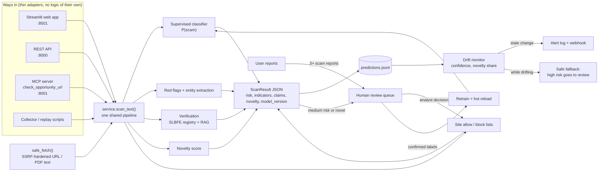

# SafePassage LK

Detects fraudulent local-job, overseas-job, student-visa and migration offers aimed at Sri Lankans, whether they arrive as posts, links or documents, and notices when scam tactics shift.

> TensorForge 2.0 Final-Forge build (17 Oct 2026). Results are risk assessments, not fraud determinations.

## Problem and users

Job fraud reaches Sri Lankans wherever they look for work:

- **At home:** Telegram/WhatsApp "task" jobs that pay small amounts first and then demand "prepaid tasks". Fake government and bank vacancies that misuse official logos to collect fees and NIC/passport copies. Sri Lanka CERT received 7,210 online-scam complaints in 2024, about 1,440 of them financial fraud, including job-offer fraud.
- **Abroad:** about 311,000 Sri Lankans left for foreign jobs in 2025. In the same year SLBFE received about 4,700 foreign-employment complaints, filed 791 court cases and recovered more than Rs. 374M. Single victims lose up to Rs. 13M, often borrowed.
- **Study and visas:** fake education and migration agents promise "guaranteed" admission, visas or PR.

These offers arrive as social-media posts, messages, links and official-looking letters, and the tactics keep changing: new destinations, new schemes (digital-ID "verification fees", crypto and QR payments), new platforms and new languages. A detector that is accurate on launch day quietly fails a few weeks later.

**Who we protect**
- **Primary:** first-time migrant workers (especially rural women and young men), local job seekers (school leavers, graduates, part-time and work-from-home seekers), students and their parents, and families applying for visit, work or PR visas.
- **Secondary:** investigators at SLBFE, Sri Lanka CERT and the Police CID/SCIB who triage complaints, plus job-centre officers, counsellors and pre-departure trainers. They use the analyst console.

**What it does:** scores an offer's scam risk with a trained classifier and explains the red flags (English, Sinhala, Tamil, Singlish). It checks the agency and fee claims against SLBFE data, flags unfamiliar patterns, and raises an alert when incoming offers drift away from what the model was trained on. Uncertain cases and repeatedly reported sites go to a human.

## Architecture



**Design rules**
- Every way in calls the same `scan_text()`, so the website, the API, AI assistants (via MCP) and the collectors get identical results.
- Only analyst decisions change the site lists or the training data. User reports and model output never do this on their own, which protects against brigading and data poisoning.
- Text from scanned pages is treated as data to classify, never as instructions.

## Run it

### With Docker (recommended)

```bash
docker compose up --build
```

| Service | URL |
|---|---|
| Web app (scan, monitoring, analyst console) | http://localhost:8501 |
| REST API + interactive docs | http://localhost:8000/docs |
| MCP server (Streamable HTTP, localhost only) | http://localhost:8001/mcp |

`logs/`, `models/` and `data/processed/` are shared with the host. To use a newly trained model, click **Reload model** in the analyst console, or `POST /api/v1/model/reload`.

Optional: `ALERT_WEBHOOK_URL=https://... docker compose up` also posts drift alerts to a webhook.

### Without Docker (Python 3.12)

```bash
pip install -r requirements.txt
export PYTHONPATH=src            # PowerShell: $env:PYTHONPATH="src"
python scripts/train_baseline.py # creates models/baseline.joblib (until then a red-flag score is used)
uvicorn safepassage.api:app --port 8000
streamlit run app/streamlit_app.py
python -m safepassage.mcp_server
```

### Drift demo

```bash
PYTHONPATH=src python scripts/replay_shifted.py --fresh --delay 0.2
```

This streams familiar offers, then shifted tactics (new schemes, destinations and pretexts), and prints drift signals every 10 scans. Open the **Monitoring** tab while it runs to watch the alert fire. It uses `data/processed/test.csv` and `shifted.csv` when present, and built-in fictional samples otherwise.

### Use it from an AI assistant (MCP)

```bash
npx @modelcontextprotocol/inspector
```

Choose transport **Streamable HTTP** and URL `http://localhost:8001/mcp`, then call `check_opportunity_url` with a public offer link. For desktop clients that launch the server themselves, use `python -m safepassage.mcp_server --stdio`.

### API quick reference

| Method | Path | Purpose |
|---|---|---|
| POST | `/api/v1/scans/text` | Scan pasted text (optional `url` for list checks) |
| POST | `/api/v1/scans/url` | Fetch and scan a public page |
| POST | `/api/v1/scans/file` | Scan an uploaded PDF/TXT |
| GET | `/api/v1/drift` | Current drift signals |
| GET | `/api/v1/alerts` | Alert history |
| GET / POST | `/api/v1/reviews`, `/api/v1/reviews/{id}` | Review queue and analyst decisions |
| POST | `/api/v1/reports` | User report on a site |
| GET | `/api/v1/reputation` | Site allow / block lists |
| POST | `/api/v1/retrain`, `/api/v1/model/reload` | Retrain on confirmed labels, hot-swap the model |

### Tests

```bash
python -m pytest -q
```

## Monitoring and drift response

| Signal | Source | Response |
|---|---|---|
| Falling mean confidence | prediction log | `drift_detected` alert (+ webhook); high-risk scans also go to human review until it clears |
| Rising share of novel inputs | novelty score | same as above |
| Medium risk or novel input | each scan | queued for human review |
| Repeated user reports on a site | reports log | site queued for an analyst block / allow decision |
| Confirmed analyst labels | review log | `POST /api/v1/retrain` exports them to `data/processed/feedback.csv` and retrains |

Alerts fire only when the drift state changes, after at least 20 scans. The state is kept in `logs/alerts.jsonl`, so the API, web app and scripts all agree.

## Data sources and licences

No real personal data is used anywhere (Rule 2.4, PDPA No. 9 of 2022). No private groups or chats are scraped.

| Data | Source | Licence / method | Used for |
|---|---|---|---|
| EMSCAD: 17,880 real job ads, 866 fraudulent (University of the Aegean) | [Hugging Face mirror](https://huggingface.co/datasets/victor/real-or-fake-fake-jobposting-prediction), downloaded by `scripts/make_dataset.py` | CC0 1.0 | Train (80%) and held-out test (20%, stratified). 4,000 legit ads kept so EMSCAD doesn't drown the Sri Lankan data. Ads are trimmed to 1,500 characters. |
| Synthetic Sri Lankan offers: scam and legit, 4 categories (local job, foreign job, student visa, visa/PR), English, Sinhala, Singlish | `scripts/generate_synthetic.py` → `data/synthetic/` | Generated by us; deterministic (fixed seed). All agency names, licence numbers and phone numbers (`07X XXX XXXX`) are fictional placeholders. | Train pool; held-out pool (about half its phrasing comes from a reserved pool never used in training) |
| **Shifted set**: 800 offers with Tamil text and new tactics (crypto and QR payments, digital-ID "verification fees", cyber-scam compounds, social/live-stream recruitment, military recruitment) and new destinations | `scripts/generate_synthetic.py` → `data/synthetic/shifted.csv` | Generated by us | Drift demo and shifted evaluation only; never used for training |
| SLBFE job classification: 821 job titles with manpower level | [services.slbfe.lk/Info/JobClassification](https://services.slbfe.lk/Info/JobClassification), via `scripts/scrape_slbfe.py` (identified user agent, 1 request/s) | Public government page; job titles only | Spotting professional-level jobs in the fee checks |
| SLBFE fee rules: registration fee, no-fee rule for Middle East domestic work, highest published fee cap | [SLBFE registration](https://www.slbfe.lk/how-to-register-for-a-received-foreign-job/), [Sunday Times](https://www.sundaytimes.lk/221127/news/human-trafficking-us-report-highlights-lankas-failures-503423.html), [The Morning](https://themorning.lk/foreign-job-seekers-charged-exorbitantly), retrieved 17 Oct 2026 → `data/kb/fee_rules.json` | Facts from public sources, each cited | Fee claims in the verifier |
| Agency registry | `data/kb/registry_demo.csv` | **Fictional demo agencies**, labelled as such. SLBFE's licensed-agency list isn't published in a public machine-readable form, and its account-only search was not used. A legitimately obtained list can be loaded with `scrape_slbfe.py --agencies FILE`. | Agency and licence checks |

**Splits** (built by `scripts/make_dataset.py` into `data/processed/`):

| Split | Rows | Composition |
|---|---|---|
| train | 7,764 | EMSCAD 3,199 legit / 565 scam, synthetic 2,141 legit / 1,859 scam |
| held-out test | 1,942 | EMSCAD 801 legit / 141 scam, synthetic 554 legit / 446 scam |
| shifted | 800 | synthetic-shifted 307 legit / 493 scam |

Reproduce everything (about a minute):

```bash
export PYTHONPATH=src
python scripts/make_dataset.py      # downloads EMSCAD, builds the splits
python scripts/train_baseline.py    # scam + content-type classifiers
python scripts/evaluate.py          # reports/eval.json
python scripts/calibrate_drift.py   # novelty index + drift thresholds, reports/drift_calibration.json
```

## Evaluation results

**Model:** logistic regression on word 1–2-gram + character 2–5-gram TF-IDF features. The character n-grams carry Sinhala, Tamil and Singlish without a translation step. A second classifier predicts the content type. Numbers come from `reports/eval.json`. Neither the test set nor the shifted set was used in training.

### Held-out test set (n = 1,941, 30% scam)

| Slice | n | Accuracy | Precision | Recall | F1 | ROC-AUC |
|---|---|---|---|---|---|---|
| **Overall** | 1,941 | 0.883 | 0.745 | **0.932** | 0.828 | **0.975** |
| EMSCAD (real ads) | 941 | 0.949 | 0.904 | 0.738 | 0.812 | 0.977 |
| Synthetic Sri Lankan | 1,000 | 0.821 | 0.716 | 0.993 | 0.832 | 0.983 |
| English | 1,426 | 0.921 | 0.814 | 0.891 | 0.851 | 0.979 |
| Sinhala | 228 | 0.763 | 0.640 | 1.000 | 0.780 | 0.968 |
| Singlish | 287 | 0.787 | 0.686 | 0.992 | 0.811 | 0.974 |

Content-type accuracy on the synthetic test rows: 1.00.

The model leans towards recall: it misses few scams (recall 0.93) and over-flags some legitimate offers (precision 0.75), especially in Sinhala and Singlish. That's deliberate for a pre-payment warning tool. A false alarm costs a phone call to SLBFE, while a missed scam can cost millions of rupees. Medium-risk scores go to human review rather than being shown as verdicts.

### Shifted set (n = 800): how the model holds up on new tactics

| Tactic | n | Accuracy | Recall | Mean confidence |
|---|---|---|---|---|
| **Overall** | 800 | 0.884 | 0.935 | **0.810** (held-out: 0.907) |
| Tamil-language offers | 323 | 0.882 | 0.977 | 0.781 |
| Digital-ID "verification fee" | 55 | **0.691** | **0.630** | 0.731 |
| Social / live-stream recruitment | 57 | 0.877 | 0.837 | 0.758 |
| Cyber-scam compound jobs | 44 | 0.909 | 0.892 | 0.758 |
| Crypto payment | 47 | 1.000 | 1.000 | 0.830 |
| QR payment | 62 | 1.000 | 1.000 | 0.883 |
| Military recruitment | 55 | 1.000 | 1.000 | 0.858 |

Accuracy stays reasonable overall, but **confidence drops** and the newest pretext (digital-ID fees) is where the model starts to fail. That silent degradation is exactly what the monitoring layer is built to catch.

### Drift detection (`reports/drift_calibration.json`)

Thresholds are calibrated on 300 bootstrap windows of 200 predictions each: above normal held-out traffic, below the shifted set.

| Signal | Normal traffic, p99 | Shifted, median | Threshold |
|---|---|---|---|
| Language-mix PSI | 0.036 | 3.66 | 0.94 |
| Content-type PSI | 0.067 | 1.38 | 0.40 |
| Confidence drop | 0.019 | 0.098 | 0.038 |
| Novelty share | 0.045 | 0.39 | 0.13 |

| Scenario | Drift detected in |
|---|---|
| Normal held-out traffic | **0%** of windows (no false alarms) |
| 100% shifted traffic | **100%** of windows |
| 50% shifted mixed with normal | 100% |
| 25% shifted mixed with normal | 20% (early warning only) |

**End-to-end check:** `scripts/replay_shifted.py` streams 120 held-out offers (no alert), then shifted offers through the live service. The drift alert fires within 60 shifted scans, and high-risk scans switch to human review.

## Impact statement

**Who is protected.** People about to pay for a job, study place or visa they found online, by phone or on paper:
- First-time migrant workers, especially rural women going into domestic work and young men chasing Gulf, Korea, Israel, Japan or Europe jobs.
- Local job seekers targeted by "task" jobs and fake government vacancies.
- Students and families dealing with education and migration agents.

They get a plain-language warning, with reasons, *before* they hand over money or their passport. Investigators get a triage queue instead of a pile of complaints.

**How many we could reach.**
- About 311,000 Sri Lankans left for foreign employment in 2025, and the government targets 350,000 for 2026.
- More than 25,000 students study abroad.
- The pool of local job seekers reached by online job ads is larger still.

Every one of these people passes through channels we can sit in: SLBFE registration and pre-departure training, job centres, school and university counselling, and the public web.

**Measurable harm prevented.**
- About 6,200 job-related fraud cases are reported each year: about 4,700 to SLBFE (2025) and about 1,440 CERT financial-fraud complaints (2024).
- SLBFE alone recovered more than Rs. 374M for victims in 2025, and individual losses reach Rs. 13M.
- Preventing even **10% of reported cases**, at a conservative Rs. 1M average loss, avoids **about Rs. 500M of losses a year**. Reported cases are a lower bound, because most victims never report.
- What we would measure in a pilot:
  - warnings shown before payment
  - the share of high-risk offers later confirmed as scams by analysts
  - time from a new scam tactic appearing to a drift alert
  - complaints per 1,000 departures in pilot districts

**Path to adoption.**
1. **Pilot (3 months): triage tool for SLBFE's investigations team or Sri Lanka CERT.** Analysts already receive these complaints. Our console ranks them, checks agency and fee claims, and flags new tactics. It runs on one small server with Docker, and no data leaves the institution.
2. **Public checker:** web and WhatsApp-style "check this offer" links from SLBFE, CERT and CBSL's "Be Scam Proof" pages. Any site or assistant can integrate through the REST API or the MCP tool.
3. **Scale:** pre-departure training centres and job centres use it with first-time applicants. The official licensed-agency list replaces the demo registry, and analyst-confirmed reports keep the model current.

## Limitations

- The agency registry is a **fictional demo**. Real licence checks need SLBFE's licensed-agency list.
- `fee_rules.json` uses Rs. 450,000 as the highest published fee cap. Current SLBFE job orders go higher: approved Japan SSW orders list a maximum of about Rs. 1.12M (approved Nov 2025). Legitimate high-fee job orders can therefore be marked as contradicted until the cap is updated or checked per job order.
- Much of the Sri Lankan training data is synthetic, and Sinhala and Singlish precision is lower (0.64–0.69). Analyst-confirmed labels from the review queue are the route to real-world data.
- Mixed traffic with only about 25% new-tactic offers is detected in 20% of windows, so early drift is caught later than full drift.
- The verifier is deterministic (registry and rule checks). There is no LLM claim checker yet.
- Image (screenshot) OCR and voice-note transcription are not implemented. Text, links and PDFs are.
