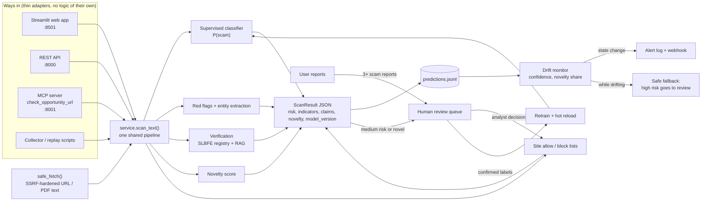

# SafePassage LK

Detects fraudulent local-job, overseas-job, student-visa and migration offers aimed at Sri Lankans, whether they arrive as posts, links or documents, and notices when scam tactics shift.

> TensorForge 2.0 Final-Forge build (17 Oct 2026). Results are risk assessments, not fraud determinations.

## Problem and users

Job fraud reaches Sri Lankans wherever they look for work:

- **At home:** Telegram/WhatsApp "task" jobs that pay small amounts first and then demand "prepaid tasks". Fake government and bank vacancies that misuse official logos to collect fees and NIC/passport copies. Sri Lanka CERT received 7,210 online-scam complaints in 2024, about 1,440 of them financial fraud, including job-offer fraud.
- **Abroad:** about 311,000 Sri Lankans left for foreign jobs in 2025. In the same year SLBFE received about 4,700 foreign-employment complaints, filed 791 court cases and recovered more than Rs. 374M. Single victims lose up to Rs. 13M, often borrowed.
- **Study and visas:** fake education and migration agents promise "guaranteed" admission, visas or PR.

These offers arrive as social-media posts, messages, links and official-looking letters, and the tactics keep changing: new destinations, new schemes (digital-ID "verification fees", crypto and QR payments), new platforms and new languages. A detector that is accurate on launch day quietly fails a few weeks later.

**Who we protect**
- **Primary:** first-time migrant workers (especially rural women and young men), local job seekers (school leavers, graduates, part-time and work-from-home seekers), students and their parents, and families applying for visit, work or PR visas.
- **Secondary:** investigators at SLBFE, Sri Lanka CERT and the Police CID/SCIB who triage complaints, plus job-centre officers, counsellors and pre-departure trainers. They use the analyst console.

**What it does:** scores an offer's scam risk with a trained classifier and explains the red flags (English, Sinhala, Tamil, Singlish). It checks the agency and fee claims against SLBFE data, flags unfamiliar patterns, and raises an alert when incoming offers drift away from what the model was trained on. Uncertain cases and repeatedly reported sites go to a human.

## Architecture



**Design rules**
- Every way in calls the same `scan_text()`, so the website, the API, AI assistants (via MCP) and the collectors get identical results.
- Only analyst decisions change the site lists or the training data. User reports and model output never do this on their own, which protects against brigading and data poisoning.
- Text from scanned pages is treated as data to classify, never as instructions.

## Run it

### With Docker (recommended)

```bash
docker compose up --build
```

| Service | URL |
|---|---|
| Web app (scan, monitoring, analyst console) | http://localhost:8501 |
| REST API + interactive docs | http://localhost:8000/docs |
| MCP server (Streamable HTTP, localhost only) | http://localhost:8001/mcp |

`logs/`, `models/` and `data/processed/` are shared with the host. To use a newly trained model, click **Reload model** in the analyst console, or `POST /api/v1/model/reload`.

Optional: `ALERT_WEBHOOK_URL=https://... docker compose up` also posts drift alerts to a webhook.

### Without Docker (Python 3.12)

```bash
pip install -r requirements.txt
export PYTHONPATH=src            # PowerShell: $env:PYTHONPATH="src"
python scripts/train_baseline.py # creates models/baseline.joblib (until then a red-flag score is used)
uvicorn safepassage.api:app --port 8000
streamlit run app/streamlit_app.py
python -m safepassage.mcp_server
```

### Drift demo

```bash
PYTHONPATH=src python scripts/replay_shifted.py --fresh --delay 0.2
```

This streams familiar offers, then shifted tactics (new schemes, destinations and pretexts), and prints drift signals every 10 scans. Open the **Monitoring** tab while it runs to watch the alert fire. It uses `data/processed/test.csv` and `shifted.csv` when present, and built-in fictional samples otherwise.

### Use it from an AI assistant (MCP)

```bash
npx @modelcontextprotocol/inspector
```

Choose transport **Streamable HTTP** and URL `http://localhost:8001/mcp`, then call `check_opportunity_url` with a public offer link. For desktop clients that launch the server themselves, use `python -m safepassage.mcp_server --stdio`.

### API quick reference

| Method | Path | Purpose |
|---|---|---|
| POST | `/api/v1/scans/text` | Scan pasted text (optional `url` for list checks) |
| POST | `/api/v1/scans/url` | Fetch and scan a public page |
| POST | `/api/v1/scans/file` | Scan an uploaded PDF/TXT |
| GET | `/api/v1/drift` | Current drift signals |
| GET | `/api/v1/alerts` | Alert history |
| GET / POST | `/api/v1/reviews`, `/api/v1/reviews/{id}` | Review queue and analyst decisions |
| POST | `/api/v1/reports` | User report on a site |
| GET | `/api/v1/reputation` | Site allow / block lists |
| POST | `/api/v1/retrain`, `/api/v1/model/reload` | Retrain on confirmed labels, hot-swap the model |

### Tests

```bash
python -m pytest -q
```

## Monitoring and drift response

| Signal | Source | Response |
|---|---|---|
| Falling mean confidence | prediction log | `drift_detected` alert (+ webhook); high-risk scans also go to human review until it clears |
| Rising share of novel inputs | novelty score | same as above |
| Medium risk or novel input | each scan | queued for human review |
| Repeated user reports on a site | reports log | site queued for an analyst block / allow decision |
| Confirmed analyst labels | review log | `POST /api/v1/retrain` exports them to `data/processed/feedback.csv` and retrains |

Alerts fire only when the drift state changes, after at least 20 scans. The state is kept in `logs/alerts.jsonl`, so the API, web app and scripts all agree.

## Still to complete

- Problem and users
- Data sources and licences
- Evaluation results (held-out test set and shifted set)
- Impact statement
- AI tools used: Claude Code (Anthropic) for scaffolding, research and code assistance
