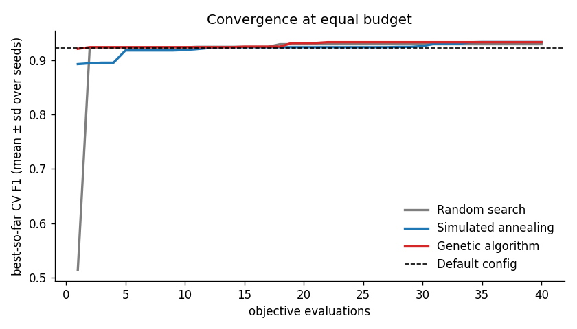

# Hyperparameter search: random search vs simulated annealing vs genetic algorithm

Generated by `scripts/tune_hparams.py`. Total runtime 4.7 min on a laptop CPU (search 226s, final refit and evaluation 52s). Raw numbers, every trial included: `reports/tuning.json`.

## Results at a glance

| Method | Best CV F1 (mean ± sd over seeds) | Test F1 [95% CI] | Precision | Recall | ROC-AUC | Test F1 minus default [95% CI] |
|---|---|---|---|---|---|---|
| Default (train_baseline.py) | 0.9227 (fixed) | 0.848 [0.822, 0.865] | 0.783 | 0.923 | 0.977 | - |
| Random search | 0.9301 ± 0.0000 | 0.836 [0.814, 0.857] | 0.759 | 0.932 | 0.972 | -0.011 [-0.020, -0.001] |
| Simulated annealing | 0.9340 ± 0.0000 | 0.835 [0.812, 0.854] | 0.760 | 0.927 | 0.972 | -0.013 [-0.021, -0.003] |
| Genetic algorithm | 0.9337 ± 0.0000 | 0.841 [0.820, 0.861] | 0.767 | 0.930 | 0.977 | -0.007 [-0.016, +0.004] |

**Honest conclusion.** On cross-validation, Simulated annealing and Genetic algorithm beat random search by more than one seed-to-seed standard deviation. On the held-out test set, the F1 difference to the default config for Genetic algorithm is inside the 95% bootstrap confidence interval (the paired CI of the difference includes 0), so we cannot claim they are better than the default. Random search, Simulated annealing are worse than the default with a paired 95% CI that excludes 0. Neither SA nor GA beats random search on the test set outside the confidence interval. The search is still worth having: it shows which knobs matter, documents that the baseline is not an accident, and gives a reproducible procedure to re-run when the data is fixed.

## Best configuration per method

| Method | Configuration | CV F1 |
|---|---|---|
| Default (train_baseline.py) | C=4, word 1-2, char (2, 5), min_df w2/c3, sublinear=True, class_weight=balanced, char_max=100k | 0.9227 |
| Random search | C=35.9, word 1-2, char (3, 5), min_df=3, sublinear=True, class_weight=balanced, char_max=100k | 0.9301 |
| Simulated annealing | C=47.9, word 1-2, char (2, 5), min_df=2, sublinear=True, class_weight=balanced, char_max=50k | 0.9340 |
| Genetic algorithm | C=33.6, word 1-3, char (2, 5), min_df=4, sublinear=True, class_weight=balanced, char_max=100k | 0.9337 |

Recommended (highest CV F1, chosen without looking at the test set): **Simulated annealing**, written to `models/best_params.json`.

## What was searched

The pipeline is the one in `scripts/train_baseline.py`: word TF-IDF and character TF-IDF (`char_wb`, which copes with Sinhala script and Singlish spelling) joined side by side, then logistic regression. Seven knobs, mixed types:

| Parameter | Type | Range | What it changes |
|---|---|---|---|
| `C` | continuous, log scale | 0.01 to 100 | inverse regularisation strength: small C = simpler model |
| `word_ngram_max` | integer | 1 to 3 | longest word phrase used as a feature |
| `char_ngram` | ordered choice | (2,4), (2,5), (3,5), (3,6) | character fragment lengths |
| `min_df` | integer | 1 to 5 | drop n-grams seen in fewer documents (both vectorizers) |
| `sublinear_tf` | boolean | False / True | use 1 + log(count) instead of the raw count |
| `class_weight` | choice | None / balanced | up-weight the minority class in the loss |
| `char_max_features` | ordered choice | 50k, 100k, 200k | vocabulary cap for character n-grams |

Word vocabulary is capped at 50,000 as in the baseline. LinearSVC was left out: at large C it needed 10+ seconds per fit to converge and gives no probabilities without an extra calibration step, which would have broken the time budget.

## How a configuration is scored (the objective)

- **Train data only.** A fixed, stratified subsample of 4,000 of the 7,764 training rows (same mix of EMSCAD/synthetic and scam/legit). `test.csv`, `shifted.csv` and the hand-written set are never read during the search.
- **Grouped, stratified 3-fold CV.** Before splitting, texts are linked when their cosine similarity is at least 0.7 after digits and `XXX` placeholders are masked; linked texts form one group (3,098 groups). `StratifiedGroupKFold` keeps every group inside one fold, so a model is never validated on a near-copy of a text it trained on (synthetic ads made from the same template lines; EMSCAD companies that reuse the same boilerplate). Without this, CV rewards memorising templates.
- **Score** = mean F1 over the folds, scam = positive class, threshold 0.5 (the same rule as `scripts/evaluate.py`). The folds are identical for every method and every seed, so differences come from the optimisers, not from luck in the split.
- **Speed trick.** For each fold, one word counter (1-3 grams) and one character counter (2-6 grams) are fitted once. Any TF-IDF setting in the space is then rebuilt from those counts by keeping the right columns (n-gram length, min_df, top-k by frequency), applying log and IDF weighting and normalising. A unit test checks that this matches scikit-learn's `TfidfVectorizer` exactly. Built matrices are cached, so a move that only changes `C` or `class_weight` costs only three logistic regression fits (run in parallel).

## The three optimisers (same budget for each)

Every run gets exactly **40 objective evaluations** and is repeated with seeds [0]. All three share the same moves, so the comparison is about the search strategy alone.

**Random search (baseline).** Draw each parameter independently from its range (C uniformly on the log scale) and keep the best. It has no memory, which makes it a fair and surprisingly strong baseline when only a few parameters matter.

**Simulated annealing (SA).** Start from a random configuration. Each step changes *one* randomly chosen parameter by a small local move:
- `C`: add Gaussian noise with sd 0.5 to log10(C), reflected back inside [0.01, 100];
- integers and ordered choices: one step up or down (bounced at the ends);
- booleans and unordered choices: switch to the other value.

The new configuration is scored, and the difference Δ = new F1 − current F1 decides whether we move there (the **Metropolis rule**): if Δ ≥ 0 always accept; if Δ < 0 accept with probability exp(Δ / T). T is the *temperature*. Early on T is high, so the search sometimes walks downhill and can escape a local optimum; as T falls it behaves more and more like greedy hill climbing. The schedule is **geometric**: T_k = T0 · α^k with **T0 = 0.015** and **α = 0.95**. Since F1 differences here are around 0.01, T0 = 0.015 accepts a 0.01 drop with probability exp(−0.01/0.015) ≈ 0.51; after 39 steps T ≈ 0.0020 and the same drop is accepted with probability ≈ 0.007. The best configuration ever seen is tracked separately from the current one.

Observed: SA accepted 82% of proposed moves on average.

**Genetic algorithm (GA).** A population of **8** configurations evolves over generations. Generation 0 is random. To build the next generation:
- **Elitism:** the best **2** individuals are copied over unchanged (and not re-scored), so the best score in the population can never go down.
- **Tournament selection:** pick 3 individuals at random and take the fittest as a parent; do this twice for two parents. Fitter configurations become parents more often, but weak ones still get a chance, which keeps diversity.
- **Uniform crossover:** the child takes each parameter from one parent or the other with probability 1/2.
- **Mutation:** each parameter of the child, independently with probability 0.2, takes one local move (the same moves SA uses).

With 40 evaluations that is 8 random individuals, then 6 new children per generation for 5 full generations plus 2 in a final partial one.
 Best score in the population per generation (seed 0): 0.9247 → 0.9247 → 0.9323 → 0.9337 → 0.9337 → 0.9337 → 0.9337 (never decreases, thanks to elitism).

## Convergence: best-so-far CV F1 after n evaluations

Mean over seeds (sd in brackets). The default config scores 0.9227 on the same folds.

| Evaluations | Random search | Simulated annealing | Genetic algorithm |
|---|---|---|---|
| 1 | 0.5142 (0.0000) | 0.8935 (0.0000) | 0.9217 (0.0000) |
| 5 | 0.9243 (0.0000) | 0.9185 (0.0000) | 0.9247 (0.0000) |
| 10 | 0.9243 (0.0000) | 0.9194 (0.0000) | 0.9247 (0.0000) |
| 15 | 0.9253 (0.0000) | 0.9246 (0.0000) | 0.9256 (0.0000) |
| 20 | 0.9301 (0.0000) | 0.9246 (0.0000) | 0.9323 (0.0000) |
| 25 | 0.9301 (0.0000) | 0.9246 (0.0000) | 0.9337 (0.0000) |
| 30 | 0.9301 (0.0000) | 0.9266 (0.0000) | 0.9337 (0.0000) |
| 35 | 0.9301 (0.0000) | 0.9340 (0.0000) | 0.9337 (0.0000) |
| 40 | 0.9301 (0.0000) | 0.9340 (0.0000) | 0.9337 (0.0000) |

## Limitations

- **CV on partly synthetic data.** About half the training rows are synthetic ads built from template lines. Grouping near-duplicates removes the most obvious leakage, but different templates still share slot values and phrasing, so CV F1 is optimistic and the ranking of configurations may not carry over to real Sri Lankan ads.
- **Overfitting the CV.** Each optimiser looked at 40 configurations and we keep the maximum, so the best CV score is biased upwards (the winner is partly the luckiest). That is why the honest comparison is the one-off held-out test score, not the CV score.
- **Small budget and few seeds.** 40 evaluations × 1 seeds is enough to compare strategies roughly, not to rank them with confidence; with more evaluations SA and GA usually pull ahead of random search on smooth spaces, and the gap can disappear when only one or two parameters matter.
- **Search on a 4,000-row subsample.** The winner is refitted on all 7,764 rows; the best `C` and `min_df` can shift with more data.
- **Threshold fixed at 0.5.** Tuning the decision threshold (for example to favour recall, since a missed scam costs more than a false alarm) is a separate, cheap step and is not part of this search.
- **Test set reused across four models.** Four refits are scored on one test set; the paired bootstrap CIs above do not correct for multiple comparisons.
